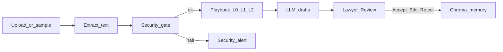

# RedlineGuard

Take-home prototype for PortSwigger’s **AI Pioneer** brief: playbook-grounded first-pass contract review for in-house legal, with generative AI drafts, MiniLM decision memory, and lite security.

**One-line promise:** Set up playbook (if needed) → upload → check playbook → flag / counter → decide → remember.

**Principle:** AI proposes. The playbook decides. The lawyer confirms.

**Same tree on GitHub:** https://github.com/New-Sheep/RedlineGuard

Printable checklist: [`docs/14-EVALUATOR-GUIDE.md`](docs/14-EVALUATOR-GUIDE.md) · Delivery decisions: [`docs/13-HANDOFF.md`](docs/13-HANDOFF.md)

---

## Start here (about 10–20 minutes)

Do these in order. Details for each step are below.

1. Install **Python 3.11+** (and pip).
2. Unzip this package **or** `git clone` (identical tree).
3. Create a virtualenv and `pip install -r requirements.txt`.
4. Copy `.env.example` → `.env` and set your **NVIDIA API key** (or switch to Ollama).
5. Run: `migrate` → `bootstrap_demo_users` → `seed_precedents` → `check_llm --draft` → `runserver`.
6. Open http://127.0.0.1:8000/ and sign in as **`lawyer` / `lawyer-demo-2026`**.
7. **Upload** → Quick demo **Sample with issues** → Review → Accept → open **Memory**.

Intended path uses a **real LLM** (`FAKE_LLM=0`) and **MiniLM** embeddings (`FAKE_EMBED=0`). That is the product. Fake fixtures are fallback only.

---

## Prerequisites

| Need | Notes |
|------|--------|
| Python **3.11+** | `python --version` |
| pip / venv | Comes with most Python installs |
| **One** LLM backend | **NVIDIA API key** from [build.nvidia.com](https://build.nvidia.com) (recommended), **or** local [Ollama](https://ollama.com) with an instruct model pulled |
| Optional `HF_TOKEN` | Hugging Face token if MiniLM download is rate-limited |
| Network (first run) | MiniLM ~90 MB once; LLM calls to NVIDIA (unless Ollama-only) |

No Docker. No hosted URL. No API keys are shipped in the zip (you add yours in `.env`).

---

## 1. Get the code

**From zip**

```bash
# Unzip RedlineGuard-PortSwigger-FINAL.zip, then:
cd RedlineGuard
```

**From GitHub**

```bash
git clone https://github.com/New-Sheep/RedlineGuard.git
cd RedlineGuard
```

Both give the same tree (samples, playbooks, docs, Django app).

---

## 2. Create a virtualenv and install dependencies

```bash
python -m venv .venv

# Windows:
.venv\Scripts\activate

# macOS / Linux:
# source .venv/bin/activate

pip install -r requirements.txt
```

**What `requirements.txt` installs (high level)**

| Package | Why |
|---------|-----|
| Django 5.x | Web app, sessions, ORM |
| pdfplumber / pypdf / python-docx | Extract PDF / DOCX / TXT |
| pydantic | Structured LLM JSON |
| chromadb | Decision memory (vector store) |
| sentence-transformers | MiniLM embeddings when `FAKE_EMBED=0` |
| python-dotenv | Load `.env` |

First `pip install` often takes **2–5 minutes** (longer if PyTorch wheels for sentence-transformers are pulled).

---

## 3. Configure `.env`

```bash
# Windows:
copy .env.example .env

# macOS / Linux:
# cp .env.example .env
```

Open `.env` and **must-fill** at least `NVIDIA_API_KEY` for the intended demo (or switch to Ollama; see below).

### Environment variables

| Variable | Required? | Example | Meaning |
|----------|-----------|---------|---------|
| `FAKE_LLM` | Yes (intended) | `0` | `0` = real generative LLM. `1` = canned draft fixtures only. |
| `FAKE_EMBED` | Yes (intended) | `0` | `0` = MiniLM for semantic memory. `1` = fast hash stubs (no download). |
| `LLM_PROVIDER` | Yes | `nvidia` | Backend: `nvidia`, `ollama`, `auto`, `deepseek`, `moonshot`, or `http`. |
| `NVIDIA_API_KEY` | If nvidia / auto | *(your key)* | From build.nvidia.com. **Leave empty only if using Ollama.** |
| `NVIDIA_MODEL` | If nvidia | `meta/llama-3.1-8b-instruct` | Chat model id on NVIDIA. |
| `HF_TOKEN` | Optional | *(your token)* | Helps if MiniLM download from Hugging Face is rate-limited. |
| `OLLAMA_HOST` | If ollama | `http://127.0.0.1:11434` | Local Ollama server. |
| `OLLAMA_MODEL` | If ollama | `qwen2.5:7b-instruct` | Model you already `ollama pull`’d. |
| `OLLAMA_TIMEOUT_S` | Optional | `120` | Seconds before Ollama call times out. |
| `LLM_JUDGE` | Optional | `1` | L2 closed-book judge on flags when `FAKE_LLM=0`. |
| `SEMANTIC_COMPARE` | Leave default | `1` | L1 semantic playbook matching. |
| `REQUIRE_AUTH` | Leave default | `1` | Session login required (demo). |
| `CHROMA_COLLECTION` | Leave default | `django_decisions_v2` | Memory collection name. |
| `MEMORY_MAX_DISTANCE` | Leave default | `0.45` | How close a precedent must be to reuse. |

**Minimal intended `.env` (NVIDIA):**

```env
FAKE_LLM=0
FAKE_EMBED=0
LLM_PROVIDER=nvidia
NVIDIA_API_KEY=paste_your_key_here
NVIDIA_MODEL=meta/llama-3.1-8b-instruct
SEMANTIC_COMPARE=1
```

**Ollama instead of NVIDIA:** set `LLM_PROVIDER=ollama`, install Ollama, run `ollama pull qwen2.5:7b-instruct` (or your `OLLAMA_MODEL`), leave `NVIDIA_API_KEY` empty. Optionally run `python manage.py check_ollama`.

Full commented template: [`.env.example`](.env.example).

---

## 4. Database, demo users, LLM smoke, server

Run from the project root (venv activated):

```bash
python manage.py migrate
python manage.py bootstrap_demo_users
python manage.py seed_precedents
python manage.py check_llm --draft
python manage.py runserver
```

### What each command does

| Command | Why you run it |
|---------|----------------|
| `migrate` | Creates local SQLite tables (`db.sqlite3`). Safe to re-run. |
| `bootstrap_demo_users` | Creates demo accounts (lawyer + admin). Idempotent. |
| `seed_precedents` | Loads a few memory precedents so Journey B works before your first Accept. Optional but recommended. |
| `check_llm --draft` | Calls your real LLM once. **Do this before the UI** so you know the key/model works. |
| `runserver` | Serves the app at http://127.0.0.1:8000/ |

---

## 5. Login and auth

Open http://127.0.0.1:8000/ (you will be sent to login if needed).

| Username | Password | Role | Use for |
|----------|----------|------|---------|
| **`lawyer`** | **`lawyer-demo-2026`** | Lawyer | Primary demo: upload, review, Accept / Edit / Reject |
| **`admin`** | **`admin-demo-2026`** | Admin | Lab resets at `/lab/` (type `RESET` to confirm) |

- Auth is **session-based** (Django login). Default `REQUIRE_AUTH=1`.
- These passwords are **demo-only**. Do not reuse elsewhere.
- After first lawyer login you may see a short onboarding wizard: complete it or skip as offered.

---

## Expected cold-start times

Honest ranges on a normal laptop / office network:

| Step | Typical time |
|------|----------------|
| `pip install -r requirements.txt` | ~2–5 min (longer if torch / sentence-transformers wheels download) |
| First MiniLM load (`FAKE_EMBED=0`) | ~1–5 min once (~90 MB); later starts reuse the cache |
| `check_llm --draft` | ~10–60 s (NVIDIA latency) |
| First contract analyze (live LLM) | ~30–90 s typical |
| Playbook PDF propose (live LLM) | Can be longer (tens of seconds to a couple of minutes) |
| Later analyzes (models warmed) | Usually faster |

If the first `runserver` looks “stuck,” check the terminal: MiniLM may still be downloading.

---

## 5-minute demo path (after login)

1. Go to **Upload**.
2. Click **Sample with issues** (or **Short NDA**).
3. Wait on **Processing** (reading → security → playbook → draft).
4. On **Review**, open a flag, open rewrite, **Accept** (or Edit / Reject).
5. Open **Memory** (`/memory/`) and confirm the decision appears.
6. **Journey C:** click **Unsafe sample** → expect a **security halt** (not a normal review).
7. **Journey E:** `/playbook/` → Import playbook PDF (e.g. Sample Playbook1) → edit proposed rules → **Activate**.

Also try your own PDF / DOCX / TXT. Prefer text-based PDFs (scanned image PDFs usually fail with a clear message).

---

## Architecture (short)



| App package | Responsibility |
|-------------|----------------|
| `apps/contracts` | Upload, extract, processing status |
| `apps/security` | Sanitize, injection detect, adjudicate, halt |
| `apps/review` | Playbook compare, drafts, rewrite UI, playbook import |
| `apps/decisions` | Accept / Edit / Reject history, thin JSON APIs |
| `apps/learning` | Chroma memory, precedents, Unlearn |
| `apps/accounts` | Session auth, roles, onboarding, lab |
| `apps/core` | LLM clients, embeddings, shared helpers |

**Stack:** Django templates + SQLite + local Chroma. No React. LLM via NVIDIA / Ollama / other OpenAI-compatible HTTP.

Deeper map: [`docs/06-PRODUCT-MAP.md`](docs/06-PRODUCT-MAP.md) · backend plan: [`docs/05-DJANGO-BACKEND-PLAN.md`](docs/05-DJANGO-BACKEND-PLAN.md) · compare layers: [`docs/08-COMPARE-ALGORITHM-AUDIT.md`](docs/08-COMPARE-ALGORITHM-AUDIT.md)

---

## APIs (thin JSON)

Session auth required when `REQUIRE_AUTH=1`. Mutating calls need CSRF.

| Method | Path | Purpose |
|--------|------|---------|
| GET | `/api/contracts/` | List contracts |
| GET | `/api/findings/?contract_id=` | Findings for a contract |
| GET / PATCH / DELETE | `/api/decisions/<uuid>/` | Decision detail; DELETE = undo |
| GET | `/api/memory/` | Precedents |
| DELETE | `/api/memory/<id>/` | Unlearn |
| GET | `/api/playbook/` | Active playbook |
| GET | `/api/audit/` | Audit log (append-only) |

Full table: [`docs/11-LAWYER-API.md`](docs/11-LAWYER-API.md)

Main HTML routes: `/login/`, `/` (upload), `/contracts/`, `/history/`, `/memory/`, `/playbook/`, `/audit/`, `/help/`, `/trust/`, `/lab/`.

---

## Design

UI mockups (Upload → Processing → Review → Rewrite): [`designs/README.md`](designs/README.md). Shipped UI is Django SSR with the same flow; Stitch folders are visual reference only.

---

## Fallback only (no API key / no Ollama)

If you cannot reach a model, set in `.env`:

```env
FAKE_LLM=1
FAKE_EMBED=1
```

The UI, playbook matching, and security halt still run; **drafts are canned fixtures**. Fine for smoke tests. **Not** the AI Pioneer story. Prefer fixing `check_llm --draft` instead.

---

## Troubleshooting

| Symptom | What to try |
|---------|-------------|
| `check_llm` fails / auth error | Confirm `NVIDIA_API_KEY` in `.env`, `FAKE_LLM=0`, `LLM_PROVIDER=nvidia`. Restart shell after editing `.env`. |
| MiniLM download fails | Set `HF_TOKEN`, or temporarily `FAKE_EMBED=1` to unblock UI (memory quality drops). |
| Port 8000 in use | `python manage.py runserver 8001` |
| Scanned PDF fails extract | Use Quick demos or a text-based PDF / DOCX / TXT. |
| Drafts look like stubs | You are still on Fake, or LLM failed open. Re-run `check_llm --draft`. |
| Unsafe sample missing | File should be `data/scratch_corpus/injection_hostile.txt` on the full tree / GitHub. |

---

## What’s in this package

| Included | Not included |
|----------|--------------|
| Full Django app, templates, static CSS | `.venv`, `.env` with secrets |
| Sample contracts, playbook PDFs, golden `playbook_config.json` | Runtime `db.sqlite3`, Chroma under `data/vector_memory/` |
| Hostile / injection demos (Journey C) | Docker / `.exe` / hosted deploy |
| Docs + designs | Production compliance claims |

---

## Approach (for reviewers)

| Idea | Meaning here |
|------|----------------|
| Playbook compiler | Flags cite company rules in `playbook_config.json` |
| Setup co-pilot | PDF import or starter from past contracts; lawyer Activates |
| Decision memory | Clause-excerpt Chroma + MiniLM; provenance; Reject = Avoid |
| Override | Append-only overrides; never silently rewrite the golden playbook |
| Security | Sanitize + injection halt + adjudicator; upload size cap |
| Generative drafts | Real NVIDIA / Ollama when `FAKE_LLM=0` |

---

## Deeper docs (after you can run)

1. [`docs/14-EVALUATOR-GUIDE.md`](docs/14-EVALUATOR-GUIDE.md) — one-page checklist  
2. [`docs/13-HANDOFF.md`](docs/13-HANDOFF.md) — why local / zip / no Docker  
3. [`docs/00-WHAT-WE-ARE-BUILDING.md`](docs/00-WHAT-WE-ARE-BUILDING.md) — product in plain English  
4. [`docs/01-PRD-MVP.md`](docs/01-PRD-MVP.md) — Must / Should / Won’t  
5. [`docs/06-PRODUCT-MAP.md`](docs/06-PRODUCT-MAP.md) — flows and statuses  
6. [`docs/07-MVP-AUDIT-CHECKPOINT.md`](docs/07-MVP-AUDIT-CHECKPOINT.md) — shipped vs PRD  
7. [`docs/08-COMPARE-ALGORITHM-AUDIT.md`](docs/08-COMPARE-ALGORITHM-AUDIT.md) — L0 + L1 + L2  

Vision-only (not how to run): `docs/CLAUDE_PORTSWIGGER.md`

**Conflict rule:** README + handoff + PRD win over vision docs.

---

## Smoke checklist

- [ ] `check_llm --draft` succeeds with live model  
- [ ] Journey **A:** Sample with issues → flags cite rules → Accept → Memory  
- [ ] Journey **B:** seed precedents or prior Accept → memory / Override  
- [ ] Journey **C:** Unsafe sample → Security alert  
- [ ] Journey **E:** playbook PDF import → Activate  
- [ ] UI drafts are **not** stuck on Fake fixtures  

## Limitations

- Not legal advice  
- Prototype only (local SQLite + Chroma)  
- Reviewers supply their own LLM access; keys never ship in git  
- Heuristic + layered compare; not a full production legal platform  

## Tests / evals (optional)

```bash
set FAKE_EMBED=1
python manage.py test apps.contracts apps.review apps.security apps.decisions apps.learning

set FAKE_LLM=1
python -m evals.runners.run_smoke
```
