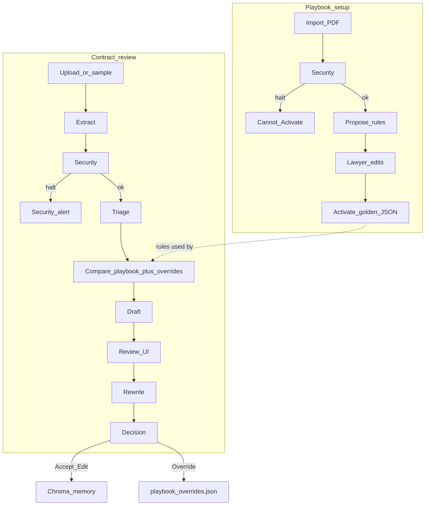
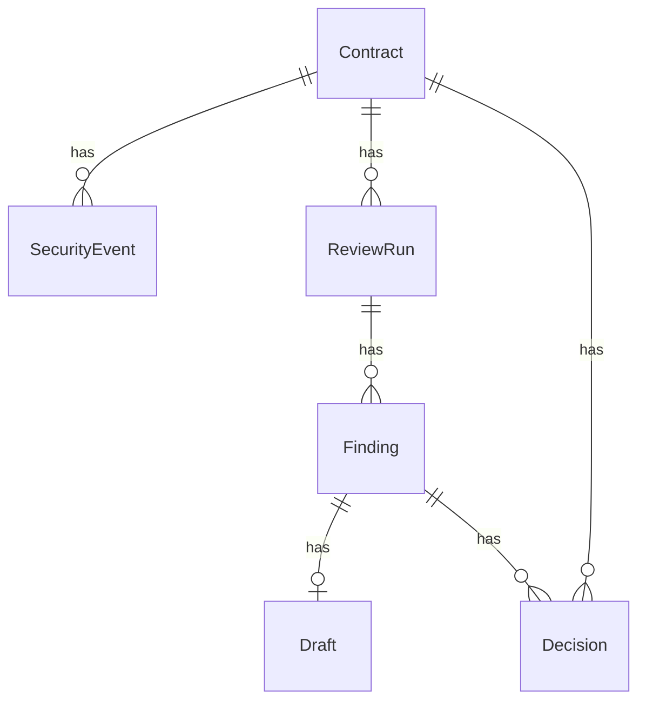

# Product map — RedlineGuard (flows, statuses, data, decisions)

| | |
|---|---|
| **Audience** | Builders, Loom/demo, future agents |
| **Status** | Living reference — reflects the **implemented** Django app |
| **Last updated** | 2026-07-18 |
| **Related** | [`00-WHAT-WE-ARE-BUILDING.md`](00-WHAT-WE-ARE-BUILDING.md) · [`01-PRD-MVP.md`](01-PRD-MVP.md) · [`05-DJANGO-BACKEND-PLAN.md`](05-DJANGO-BACKEND-PLAN.md) |

**This document is the mental model for the product going forward.** Prefer it over scattered chat when answering “what happens when…?”

---

## 1. Big picture (two products in one UI)

| Track | Job |
|--------|-----|
| **Contract review** | Upload → security → compare to playbook → flags → rewrite → decide → remember |
| **Playbook setup** | Import PDF → propose rules → lawyer Activates → that becomes the checklist |

**Principle:** AI proposes. The playbook decides. The lawyer confirms.

---

## 2. Screens you click (user flow)

| URL | Screen | When you see it |
|-----|--------|-----------------|
| `/` | Upload | Start |
| `/contracts/<id>/review/` | Review | Analysis succeeded |
| `/contracts/<id>/rewrite/<finding>/` | Rewrite | Click “Review rewrite” |
| `/security/<id>/` | Security alert | Injection / hostile text |
| `/contracts/<id>/processing/` | Processing | Rare (usually auto-redirects) |
| `/history/` | History | Past Accept/Edit/Reject/Override |
| `/memory/` | Memory | Visible precedents + overrides; Unlearn |
| `/api/memory/` | JSON | List precedents (same data as Memory page) |
| `/api/memory/search/?q=&rule_id=` | JSON | Same retrieval pipeline draft uses |
| `/api/memory/<id>/` | JSON DELETE | Unlearn (also POST) |
| `/playbook/` | Active rules | What’s checking contracts |
| `/playbook/import/` → `/playbook/imports/<id>/` | Import / edit / Activate | Setup |

Thin JSON memory endpoints exist for Loom/devtools; the product UI remains mostly server-rendered HTML.

Playbook import is **async** like contract analyze: POST `/playbook/import/` → `/playbook/imports/<id>/processing/` (progress bar + steps) → detail when proposed. Poll `/playbook/imports/<id>/status.json`.

---

## 3. Contract lifecycle (statuses)

What `Contract.status` means (`apps.contracts.models.Contract`):

| Status | Meaning | What you see |
|--------|---------|--------------|
| `uploaded` | Row created, file/sample attached | Brief |
| `extracted` | Text pulled from PDF/TXT | Intermediate |
| `processing` | Pipeline running | Usually flashes by |
| `ready` | Review available | **Review** page |
| `halted` | Security stopped the run | **Security alert** |
| `failed` | Extract/analyze error | Error message |

Typical happy path: `uploaded` → `extracted` → `processing` → `ready`.

---

## 4. What happens inside one analysis

Order in `apps.review.services.pipeline.run_pipeline`:

1. **Extract** — PDF/TXT → `extracted_text` (already done before pipeline if upload path ran extract)  
2. **Security** — sanitize + injection detect → `SecurityEvent`; if halt → stop (`halted`)  
3. **Triage** — rough kind/stakes (e.g. `nda`, `routine_queue`) — labels only  
4. **Playbook compare** — load golden JSON, **remove overridden rules**, match patterns → findings  
5. **Draft** — for each finding: search Chroma on **clause excerpt** (not playbook reason); apply `MEMORY_MAX_DISTANCE`; skip Accept reuse if a near **Reject** exists; else playbook fallback / LLM  
6. Persist **`ReviewRun` + Findings + Drafts** (Draft may store `provenance` for memory hits) → status `ready`

Empty playbook → still `ready`, but **0 findings** + “set up playbook” banner.

---

## 5. Finding + draft states (flags)

**Finding.status** (from playbook match):

| Status | Meaning |
|--------|---------|
| `FLAGGED` | Rule hit **and** playbook has fallback text → can suggest rewrite |
| `REQUIRES_HUMAN` | Rule hit **but** no fallback → no invented counter |
| `APPROVED` | In schema; heuristic compare rarely emits it today |

**Draft.draft_source**:

| Source | Meaning |
|--------|---------|
| `playbook_fallback` | Used rule’s fallback wording |
| `memory_precedent` | Reused a prior Accept/Edit from Chroma (clause-similar, under distance gate) |
| `llm_suggested` | Fake or real LLM draft when no fallback/memory (`FAKE_LLM=1` by default) |
| `none` | Nothing to propose (rare after LLM port) |

Memory drafts store **`provenance`** (filename, date, similarity, clause quote) for the Rewrite panel.

### Analyze UX (Sprint 4)

Upload returns quickly → **Processing** page polls `/contracts/<id>/status.json` while a background thread runs extract + pipeline. Progress steps: queued → reading → security → playbook → memory → draft → done. MiniLM warms at server start when `FAKE_EMBED=0`. Processing uses an animated scan SVG + rotating tips (PactPilot wait-screen pattern, Django SSR).

### Memory UX (Sprint 5)

- Findings carry **`clause_excerpt`** (matched span); Chroma collection **`django_decisions_v2`** embeds that text with metadata (`filename`, `doc_kind`, …).  
- **`MEMORY_MAX_DISTANCE`** gates reuse (default ~0.45 MiniLM / looser for hash).  
- **`/memory/`** lists precedents; **Unlearn** deletes Chroma id + sets `Decision.memory_active=False`.  
- Rejects are stored as Avoid signals and block similar Accept reuse.

### UI language (PactPilot SSR port)

Django templates stay the product UI — **no React**. Visual system lifted from PactPilot:

| Asset | Where |
|-------|--------|
| Design tokens (risk triad, primary blue, dark mode) | [`static/css/app.css`](../static/css/app.css) |
| Sticky top bar + disclaimer chip + theme toggle | [`templates/base.html`](../templates/base.html), [`static/js/theme.js`](../static/js/theme.js) |
| Review cockpit (gauge, filled severity, doc highlights) | [`templates/contracts/review.html`](../templates/contracts/review.html), [`static/js/highlight.js`](../static/js/highlight.js) |
| Color-coded Accept/Edit/Reject/Override tiles | [`templates/review/rewrite.html`](../templates/review/rewrite.html) |
| Processing SVG scene | [`templates/contracts/processing.html`](../templates/contracts/processing.html) |

**Not ported:** Chat, auth teaser, Negotiate email, shadcn/Radix, PDF export.

---

## 6. Lawyer decisions (four actions)

On Rewrite → Save (`apps.decisions.services.decide.record_decision`):

| Action | What it does |
|--------|----------------|
| **Accept** | Saves decision; writes **Chroma** (clause excerpt + final text) so next similar flag can reuse |
| **Edit** | Same as Accept, but with your edited final text → Chroma |
| **Reject** | Saves decision; writes **Chroma** as Avoid — near matches skip memory Accept reuse |
| **Override & accept as-is** | Saves decision; appends rule to **`playbook_overrides.json`**; that rule won’t flag again; **does not** change golden playbook; **no** Chroma |

---

## 7. Playbook import statuses

Separate object: `PlaybookImport`.

| Status | Meaning |
|--------|---------|
| `uploaded` | File in |
| `proposed` | Rules proposed — edit before Activate |
| `activated` | Written to `playbook_config.json` |
| `halted` | Poisoned / injection — **cannot** Activate |
| `failed` | Extract/propose error |

---

## 8. Database design (SQLite) + files outside DB

| Store | Holds |
|-------|--------|
| **SQLite** | Contract, SecurityEvent, ReviewRun, Finding, Draft, Decision, PlaybookImport |
| **`data/playbook_config.json`** | Golden rules (Activate only) |
| **`data/playbook_overrides.json`** | B2 exceptions (append-only) |
| **`data/vector_memory/` (Chroma)** | Accept/Edit/Reject precedents in `django_decisions_v2` (clause-embedded) |
| **`media/`** | Uploaded PDFs |

Relationship in practice:  
**Contract → ReviewRun → Finding → Draft**  
**Finding → Decision** (and Decision also points at Contract).

`PlaybookImport` is standalone (setup track).

---

## 9. Features checklist (what exists)

| Feature | Status |
|---------|--------|
| Upload / sample analyze | Yes (async + progress) |
| Security halt | Yes |
| Playbook-cited flags | Yes (heuristic match) |
| Fake draft + memory draft + LLM suggested | Yes (`FAKE_LLM=1` default) |
| Accept / Edit / Reject / Override | Yes |
| History | Yes |
| Memory page + Unlearn + provenance | Yes |
| Memory JSON list/search/delete | Yes |
| Reject as Avoid (blocks reuse) | Yes |
| PactPilot-style UI (SSR tokens, cockpit, highlights) | Yes |
| Playbook PDF import → Activate | Yes |
| Empty-playbook onboarding CTA | Yes |
| Curated demo samples | Yes |
| MiniLM warmup at startup | Yes (when `FAKE_EMBED=0`) |
| Real LLM compare | No (patterns only) |
| JSON REST API | Thin: status + memory |
| E2 starter from past NDAs | No |
| SSO / multi-user | No |

---

## 10. Example: real PDF on Review

When analysis finishes with status **`ready`**:

- Triage like `unknown / routine_queue` = “not classified as a special doc type”  
- A finding with **`REQUIRES_HUMAN`** and draft **`none`** means: a playbook pattern matched, but the rule has **no fallback text**, so the app asks the lawyer to decide instead of inventing a rewrite  
- Next click: **Review rewrite** → Accept / Edit / Reject / Override  

---

## 11. Mental model in one sentence

**Files + playbook JSON define policy; SQLite stores this review; Chroma remembers Accepts/Rejects (clause-based, distance-gated); overrides suppress rules; Memory page makes learning visible; thin `/api/memory/` mirrors that data.**

---

## 12. Code anchors

| Concern | Where |
|---------|--------|
| Contract statuses | `apps/contracts/models.py` |
| Pipeline | `apps/review/services/pipeline.py` |
| Background analyze | `apps/contracts/services/analyze.py` |
| LLM draft port | `apps/core/llm.py`, `apps/review/services/drafting.py` |
| Overrides merge | `apps/review/services/overrides.py` |
| Decisions | `apps/decisions/services/decide.py` |
| Playbook load / Activate | `apps/review/services/playbook_import.py` |
| Chroma adapter | `apps/learning/services/memory.py` |
| Memory catalog / Unlearn | `apps/learning/services/catalog.py`, `apps/learning/views.py` |
| URLs | `apps/*/urls.py`, `config/urls.py` |
