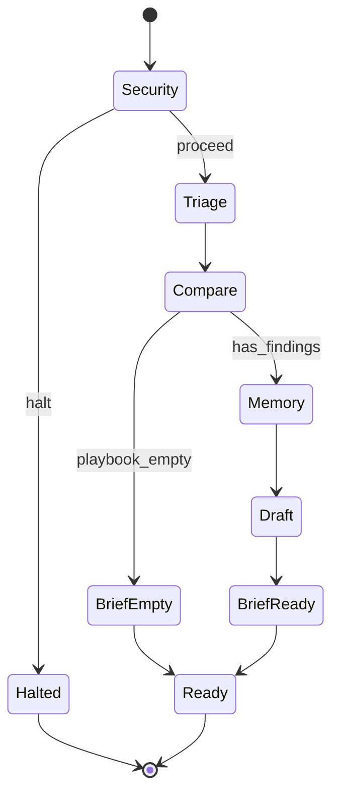

# LangGraph multi-ReAct architecture (planned)

| | |
|---|---|
| **Purpose** | Future multi-agent orchestration vision |
| **Audience** | Engineers, interview prep |
| **Status** | Spec only. Shipped path is the linear Django pipeline ([`16-CURRENT-ARCHITECTURE.md`](16-CURRENT-ARCHITECTURE.md)). |
| **Related** | [`16-CURRENT-ARCHITECTURE.md`](16-CURRENT-ARCHITECTURE.md) · [`06-PRODUCT-MAP.md`](06-PRODUCT-MAP.md) · [`08-COMPARE-ALGORITHM-AUDIT.md`](08-COMPARE-ALGORITHM-AUDIT.md) · [`12-DUAL-STORE-MEMORY.md`](12-DUAL-STORE-MEMORY.md) |

**Principle (unchanged):** AI proposes. The playbook decides. The lawyer confirms.

---

## 1. Why this document exists

Today RedlineGuard already has the **right building blocks**, but they are wired as:

1. A **manual, fixed pipeline** (`run_pipeline`: security → triage → compare → draft)
2. **Isolated LLM helpers** (plain English, decision brief, memory explain, playbook propose, security adjudicate, rewrite co-pilot, scoped ask)
3. **One narrow ReAct loop** only for Needs-human drafting (`apps/drafting/agent.py`)

That is intentional for a short take-home: deterministic, easy to demo, easy to debug.

This doc answers: **if we re-composed the same system with multiple ReAct agents on LangGraph**, what would agents, orchestration, state, and reuse look like without throwing away the current code?

```text
Today: extract → security → triage → L0/L1/L2 → draft_for_finding → UI
 (helpers called ad hoc; one ReAct island for drafts)

LangGraph: Supervisor graph routes to specialist ReAct agents
 Each agent’s tools wrap today’s Python modules
```

---

## 2. What is fragmented today (inventory to reuse)

Treat every row as a **tool or subgraph node**, not a rewrite.

| Current piece | Path | Becomes |
|---------------|------|---------|
| Extract PDF/DOCX/TXT | `apps/contracts/services/extract.py`, `scratch/poc01_extract` | Tool: `extract_document` |
| Security sanitize / detect / fence | `scratch/poc02_security/security.py` | Tools: `sanitize_text`, `detect_injection`, `fence_excerpt` |
| Security gate + adjudicator | `apps/security/services/gate.py`, `adjudicate.py` | **SecurityAgent** (+ tool `adjudicate_cues`) |
| PII redaction | `apps/security/services/redactor.py` | Tool: `redact_pii` (already in draft ReAct) |
| Triage | `scratch/poc03_triage` | Tool: `triage_contract` |
| Playbook load + overrides | `playbook_import.load_active_playbook`, `overrides.py` | Tools: `get_active_playbook`, `list_overrides` |
| L0 / L1 / L2 compare | `apps/review/services/compare/*` | Tools or **CompareAgent** subgraph |
| Chroma memory | `scratch/poc06_memory/store.py`, `apps/learning/services/memory.py` | Tools: `search_precedents`, `add_decision`, `unlearn` |
| Draft assembly | `apps/review/services/drafting.py` | Absorbed by **DraftAgent** |
| Existing draft ReAct | `apps/drafting/agent.py` + `apps/drafting/tools.py` | Drop-in **DraftAgent** loop |
| Playbook PDF propose | `playbook_bootstrap_llm.py`, `playbook_import.py` | **PlaybookSetupAgent** |
| Rewrite co-pilot / plain English / brief / scoped ask | `rewrite_copilot.py`, `plain_english.py`, `decision_brief.py`, `scoped_ask.py` | Tools on **CounselAssistAgent** |
| Persist Decision | `apps/decisions/services/decide.py` | Tool: `record_decision` (human-gated) |
| Context assist banner | `context_agent.py` | Tool or small **BriefingAgent** |

Django views, SQLite models, templates, and auth stay as the **application shell**. LangGraph becomes the **analysis brain**, invoked from `start_analyze_async` / playbook import jobs instead of (or behind) `run_pipeline`.

---

## 3. Target architecture (high level)

```mermaid
flowchart TB
 ui[Django_UI_and_APIs]
 job[Background_job]
 graph[LangGraph_ReviewGraph]

 ui --> job --> graph

 subgraph agents [ReAct_specialists]
 sec[SecurityAgent]
 cmp[CompareAgent]
 mem[MemoryAgent]
 draft[DraftAgent]
 setup[PlaybookSetupAgent]
 assist[CounselAssistAgent]
 end

 graph --> sec
 graph --> cmp
 graph --> mem
 graph --> draft
 graph --> setup
 graph --> assist

 tools[Existing_Python_modules_as_tools]
 sec --> tools
 cmp --> tools
 mem --> tools
 draft --> tools
 setup --> tools
 assist --> tools

 store[(SQLite_plus_Chroma)]
 tools --> store
```

**Layers**

1. **Presentation** - Django SSR + thin JSON APIs (unchanged)
2. **Orchestration** - LangGraph state machine / supervisor
3. **Agents** - ReAct loops with bounded tools and max iterations
4. **Tools** - thin adapters over today’s services (same SQLAlchemy-free Django ORM + Chroma)
5. **Governance** - playbook JSON, overrides, human Activate / Accept / Override

---

## 4. Shared graph state

One typed state object passed through the graph (Pydantic or TypedDict):

```text
ReviewState
 contract_id: str
 filename: str
 raw_text: str
 cleaned_text: str
 security:
 halt: bool
 matches: list
 adjudication: dict
 human_override: bool
 triage:
 kind: str
 stakes: str
 playbook:
 empty: bool
 rules: list
 overrides_applied: list
 findings: list[FindingState] # rule_id, excerpt, layer, status, …
 drafts: dict[finding_id → DraftState]
 memory_hits: dict[finding_id → list]
 agent_traces: list[TraceStep] # for /trust and Loom
 progress_step: str
 error: str | null
 ui_assist: dict # clean_pass_brief / no_playbook_scout
```

**Hard rules in state transitions**

- If `security.halt` and not `human_override` → terminal node `HALTED` (no compare, no draft, no Chroma write).
- If `playbook.empty` → skip compare/draft findings; run PlaybookSetup / Briefing assist only.
- Drafts never auto-Accept; graph ends at `READY_FOR_LAWYER`.
- `record_decision` tool is only callable from a **human-confirmed** API/view, not from unsupervised agent loops.

---

## 5. Agents (ReAct specialists)

Each agent: **Thought → Tool → Observe**, max N steps, forced `finish` tool, structured JSON final answer. Same pattern as today’s `apps/drafting/agent.py`, scaled out.

### 5.1 Supervisor / Router (graph, not chatty)

Not a free-form “do anything” agent. A **LangGraph router** with explicit edges:

| From | Condition | To |
|------|-----------|-----|
| START | always | SecurityAgent |
| SecurityAgent | halt | HALTED |
| SecurityAgent | proceed | TriageNode (tool) → CompareAgent |
| CompareAgent | playbook empty | BriefingAgent → READY |
| CompareAgent | has findings | MemoryAgent (per finding or batch) → DraftAgent |
| DraftAgent | done | BriefingAgent → READY |
| Playbook import job | START | SecurityAgent (playbook mode) → PlaybookSetupAgent → PROPOSED |

Optional: Supervisor LLM only chooses **order of assist tools** after READY (plain English, coverage gaps), never whether to skip security.

### 5.2 SecurityAgent

**Goal:** Decide hold vs proceed; never invent policy.

| Tool | Wraps |
|------|--------|
| `sanitize_text` | `sanitize` |
| `detect_injection` | `detect_injection` |
| `adjudicate_cues` | `adjudicate_security` |
| `fence_excerpt` | `fence` |
| `finish` | write `state.security` |

**ReAct sketch:** sanitize → detect → if halt cues, adjudicate → finish(hold|proceed).

**Reuse:** today’s `run_security_gate` can remain the single tool implementation so behaviour stays identical.

### 5.3 CompareAgent

**Goal:** Produce findings that **cite playbook rules**.

| Tool | Wraps |
|------|--------|
| `get_active_playbook` | load + merge overrides |
| `run_l0_regex` | `layer_rule` |
| `run_l1_semantic` | `layer_semantic` (+ MiniLM / hash embedder) |
| `run_l2_judge` | `layer_llm` (optional when `FAKE_LLM=0`) |
| `merge_findings` | `compare/merge.py` |
| `finish` | write `state.findings` |

Can be implemented as a **deterministic subgraph** (no ReAct) that only uses tools in fixed order L0→L1→L2→merge. Prefer that for demos; allow ReAct only for “discover gaps” stretch (`layer_discover`).

### 5.4 MemoryAgent

**Goal:** Retrieve usable precedents; honour Reject-avoidance.

| Tool | Wraps |
|------|--------|
| `search_precedents` | already in `drafting/tools.py` |
| `filter_usable_accepts` | `memory.filter_usable_accepts` |
| `explain_memory_hit` | `memory_assist.explain_memory_hit` |
| `finish` | write `state.memory_hits` |

Distance gate stays **`MEMORY_MAX_DISTANCE`** (code, not agent whim).

### 5.5 DraftAgent (existing ReAct, promoted)

**Goal:** Needs-human / counter text with provenance.

**Already exists:** tools `search_precedents`, `check_playbook_rule`, `redact_pii`, `propose_draft`, `escalate_human`, `finish` in `apps/drafting/tools.py`.

LangGraph change: run **one DraftAgent subgraph per finding** (parallel fan-out), with shared playbook + memory hits injected into state. Cap with `REACT_DRAFT_MAX_ITERS`.

### 5.6 PlaybookSetupAgent

**Goal:** Propose rules from PDF or past contracts; never auto-Activate.

| Tool | Wraps |
|------|--------|
| `extract_playbook_pdf` | playbook import extract |
| `detect_injection` | playbook-mode detection |
| `propose_rules_llm` | `playbook_bootstrap_llm` / upgrade path |
| `validate_rule_schema` | Pydantic / forms |
| `finish` | write `proposed` payload for Activate UI |

Activation remains a **Django POST** by the lawyer (governance).

### 5.7 CounselAssistAgent (post-READY, optional)

**Goal:** Help the lawyer understand, not change policy silently.

| Tool | Wraps |
|------|--------|
| `plain_english` | `plain_english.py` |
| `decision_brief` | `decision_brief.py` |
| `rewrite_copilot` | `rewrite_copilot.py` |
| `scoped_ask` | `scoped_ask.py` |
| `coverage_gaps` | gap suggest |
| `finish` | attach `ui_assist` / finding gloss |

Triggered on-demand from UI (button / chat pane), not on every analyze, to control cost/latency.

---

## 6. Orchestration graphs

### 6.1 Contract review graph



### 6.2 Parallelism

```text
CompareAgent finishes findings[1..N]
 → MemoryAgent.map(findings) # asyncio / LangGraph Send API
 → DraftAgent.map(findings)
 → merge into ReviewState
 → persist Finding + Draft ORM rows (same as today)
```

Keep persistence **outside** the LLM loop: a final `PersistNode` writes Django models so the graph stays testable with Fake tools.

### 6.3 Human-in-the-loop breakpoints

LangGraph `interrupt_before` / resume:

| Interrupt | Resume trigger |
|-----------|----------------|
| After HALTED | Lawyer Override & continue → set `human_override`, re-enter after Security with `skip_detection` |
| After PROPOSED playbook | Lawyer Activate |
| After READY | Lawyer Accept / Edit / Reject / Override on rewrite UI |

Agents never call Activate or Accept themselves.

---

## 7. How this fixes “isolated / manual / fragmented”

| Pain today | LangGraph redesign |
|------------|-------------------|
| Fixed `run_pipeline` order only | Explicit graph edges + optional parallel map |
| LLM helpers called from scattered services | CounselAssistAgent + shared tool registry |
| One ReAct island for drafts | Same ReAct pattern for Security / Memory / Setup |
| Hard to show “agent reasoning” | `agent_traces` in state → `/trust/` and Processing UI |
| Hard to swap providers | Tools call `complete_json` / embedders; graph stays |
| Risk of agent freelancing | Router is rule-based; tools enforce gates; max iters |

**What we deliberately do *not* change**

- Playbook as source of truth
- Dual store (ORM + Chroma)
- Local-first demo packaging
- Fake LLM / Fake embed fallbacks for offline evals

---

## 8. Suggested package layout (additive)

```text
apps/
 agents/ # NEW - LangGraph only
 graphs/
 review_graph.py # compiles StateGraph
 playbook_graph.py
 agents/
 security_agent.py
 compare_agent.py
 memory_agent.py
 draft_agent.py # thin wrapper over apps/drafting/agent.py
 playbook_setup_agent.py
 counsel_assist_agent.py
 tools/ # adapters → existing services
 extract_tools.py
 security_tools.py
 compare_tools.py
 memory_tools.py
 draft_tools.py # re-export apps/drafting/tools.py
 state.py
 tracing.py # append TraceStep → ReviewRun.agent_assist
 review/services/pipeline.py
 # run_pipeline becomes: invoke review_graph OR legacy path behind flag
```

Feature flag sketch:

```env
AGENT_ORCHESTRATOR=legacy|langgraph
REACT_DRAFT=1
REACT_DRAFT_MAX_ITERS=6
```

Default `legacy` until graph evals match Journey A/B/C/E.

---

## 9. Example: DraftAgent ReAct (already close to shipped)

Current tools in `apps/drafting/tools.py` already look like a LangGraph tool node set:

```text
search_precedents → check_playbook_rule → redact_pii → propose_draft → finish
```

Under LangGraph this becomes a subgraph node `draft_finding` with the same tools bound to the model, checkpointed per `finding_id`, traces stored on `Draft.provenance["react_trace"]` (as today).

SecurityAgent would mirror that shape with different tools and a stricter finish schema (`verdict: hold|proceed`).

---

## 10. Eval and ops (must ship with the graph)

| Check | How |
|-------|-----|
| Journey C hard injection | Graph ends HALTED; zero Chroma writes |
| Ambiguous cue | Adjudicator proceed; findings still cite rules |
| Memory Reject nearby | DraftAgent must not reuse Accept |
| Playbook empty | No fake findings; scout assist only |
| Cost / latency | Per-agent token counters on `agent_traces` (AI on Tap style visibility) |
| Offline | Fake tool implementations behind `FAKE_LLM` / `FAKE_EMBED` |

Reuse existing evals under `evals/runners/` and add a graph-vs-legacy parity suite.

---

## 11. Interview / product soundbite

“RedlineGuard today is a deliberate linear pipeline with reusable security, compare, memory, and draft modules, plus one ReAct loop for counters. A LangGraph redesign would not replace those modules; it would **orchestrate them as specialist ReAct agents** under a rule-based supervisor: Security, Compare, Memory, Draft, Playbook Setup, and Counsel Assist - with human breakpoints for halt override, Activate, and Accept/Edit/Reject. Same governance principle; clearer agent boundaries and traces.”

---

## 12. Out of scope for this vision doc

- Implementing LangGraph in the repo
- Replacing Django with a pure agent UI
- Unbounded autonomous legal negotiation
- Claiming production multi-tenant agent mesh

**Authority until shipped:** README / PRD / `run_pipeline` define behaviour. Switch to `AGENT_ORCHESTRATOR=langgraph` only when implemented and eval-gated.
