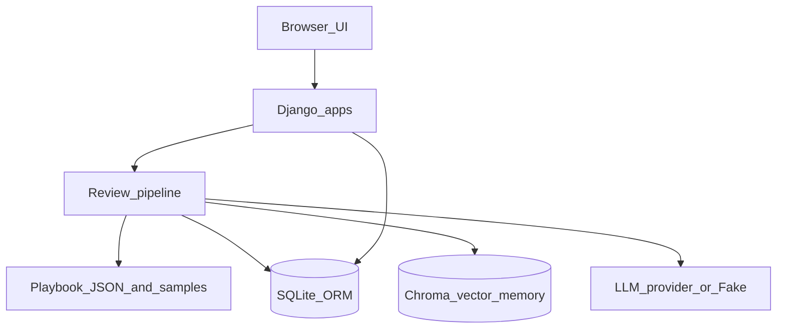
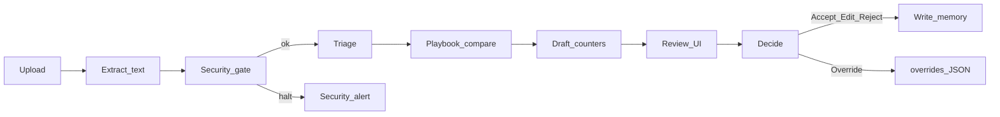

# Current architecture (as built)

| | |
|---|---|
| **Purpose** | Living technical overview of the **shipped** Django modular monolith |
| **Audience** | Engineers, interview prep, reviewers |
| **Related** | [`06-PRODUCT-MAP.md`](06-PRODUCT-MAP.md) · [`08-COMPARE-ALGORITHM-AUDIT.md`](08-COMPARE-ALGORITHM-AUDIT.md) · [`11-LAWYER-API.md`](11-LAWYER-API.md) · [`12-DUAL-STORE-MEMORY.md`](12-DUAL-STORE-MEMORY.md) · [`15-LANGGRAPH-MULTI-AGENT-ARCHITECTURE.md`](15-LANGGRAPH-MULTI-AGENT-ARCHITECTURE.md) (planned) |

**One-line product:** Upload a routine contract → check it against the company playbook → flag issues → suggest counters → lawyer Accept / Edit / Reject → remember.

**Principle:** AI proposes. The playbook decides. The lawyer confirms.

---

## 1. Big picture

RedlineGuard is a **local Django modular monolith**:

- Server-rendered UI (templates + static CSS)
- Background analysis jobs (threads) with a Processing progress UI
- SQLite for application data
- Local Chroma for decision-memory vectors
- LLM via NVIDIA / Ollama / other OpenAI-compatible HTTP (or Fake fixtures)

No microservices. No hosted deploy required for the take-home.



**Two product tracks in one app**

| Track | What the user does |
|-------|--------------------|
| **Contract review** | Upload / Quick demo → review flags → rewrite → decide |
| **Playbook setup** | Import PDF or past contracts → edit proposed rules → **Activate** |

---

## 2. Repo layout (components)

```text
redlineguard/
├── manage.py
├── config/ # settings, urls, middleware
├── apps/
│ ├── accounts/ # login, roles, onboarding, lab reset
│ ├── contracts/ # upload, extract, Contract lifecycle
│ ├── security/ # gate, adjudicate, PII redactor
│ ├── review/ # pipeline, compare, draft, playbook import/library
│ ├── decisions/ # Accept/Edit/Reject/Override, history, audit APIs
│ ├── learning/ # Chroma adapter, Memory UI, seed_precedents
│ ├── drafting/ # optional narrow ReAct loop for Needs-human drafts
│ └── core/ # LLM clients, uploads, rate limit, labels
├── data/ # playbook_config.json, samples, vector_memory/
├── templates/ + static/ # SSR UI
├── scratch/ # original CLI POCs (behaviour reused by apps)
└── docs/
```

| App | Responsibility | How (high level) |
|-----|----------------|------------------|
| **accounts** | Who can use the demo | Session auth; roles `lawyer` / `admin`; onboarding wizard; `/lab/` resets |
| **contracts** | Get text into the system | Upload PDF/DOCX/TXT or sample key → extract → status machine → kick off analyze |
| **security** | Treat uploads as untrusted | Sanitize → injection detect → optional LLM adjudicate → halt or proceed; PII redact before cloud LLM |
| **review** | Core product brain | `run_pipeline`: security → triage → layered playbook compare → draft per finding → persist ReviewRun |
| **decisions** | Lawyer judgement | Record Accept/Edit/Reject/Override/False-positive; History; thin JSON APIs; audit events |
| **learning** | Remember similar clauses | Embed clause excerpts into Chroma; search on draft; Memory page + Unlearn |
| **drafting** | Optional multi-step draft | Small ReAct tool loop (`search_precedents`, `propose_draft`, …) when enabled |
| **core** | Shared infra | `complete_json`, provider presets, Fake LLM, upload size checks, rate limits |

**Scratch** (`scratch/poc0*`) remains the lab that seeded Django: extract, security, triage, playbook, memory store, draft engine.

---

## 3. End-to-end contract review (how it works)



### Step by step

1. **Upload** (`contracts`) 
 User picks a Quick demo or file. Creates a `Contract` row. Starts background analyze.

2. **Extract** 
 PDF / DOCX / TXT → `extracted_text`. Image-only PDFs fail with a clear message.

3. **Security gate** (`security`) 
 Sanitize text; detect injection-style cues; optionally adjudicate ambiguous cues. 
 If **halt** → status `halted`, Security alert page, pipeline stops (no normal findings / no memory write). 
 Lawyer may **Override & continue** (explicit human gate).

4. **Triage** 
 Light labels (e.g. kind/stakes) for UI context only.

5. **Playbook compare** (`review/services/compare`) 
 Load active `playbook_config.json`, apply overrides (drop suppressed rules), then:
 - **L0** regex / rule patterns 
 - **L1** local semantic match (MiniLM or hash embedder) 
 - **L2** optional LLM judge when `FAKE_LLM=0` 
 Each finding cites a `playbook_rule_id` and keeps clause offsets for highlighting.

6. **Draft** (`review/services/drafting`, optional `drafting` ReAct) 
 For each finding, in order of preference:
 - Reuse a close **memory** Accept/Edit (distance gate; skip if near Reject) 
 - Else playbook fallback text 
 - Else LLM suggested counter 
 - Else Fake fixture (offline) 
 Persist `Finding` + `Draft` rows.

7. **Review / Rewrite UI** 
 Document + flags; open rewrite; Accept / Edit / Reject / Override.

8. **Decide** (`decisions`) 
 Write ORM `Decision` + audit. Accept/Edit/Reject also embed the clause into **Chroma**. Override appends `playbook_overrides.json` (does not rewrite the golden playbook).

---

## 4. Playbook setup (second track)

| Function | What | How |
|----------|------|-----|
| **View active playbook** | See company rules | Read golden JSON (+ library UI) |
| **Import PDF** | Bootstrap rules from a playbook doc | Async job: extract → security → propose rules (Fake-first then optional LLM upgrade) → edit form → **Activate** |
| **Starter from past contracts** | Propose rules from 3-5 NDAs | Same propose → Activate pattern |
| **Activate** | Make rules live | Writes/backs up `data/playbook_config.json` |
| **Library** | Save / edit / combine / delete playbooks | ORM library rows + activate into golden file |

Poisoned / hostile playbook input → security halt → **cannot Activate**.

---

## 5. Data stores

| Store | Holds | Role |
|-------|--------|------|
| **SQLite (Django ORM)** | Contract, SecurityEvent, ReviewRun, Finding, Draft, Decision, AuditEvent, users, playbook library | System of record for UI, history, undo |
| **Chroma** (`data/vector_memory`, collection `django_decisions_v2`) | Embedded **clause excerpts** + decision metadata | Retrieval index for drafting / Memory search |
| **JSON files** | `playbook_config.json`, `playbook_overrides.json` | Policy + append-only exceptions |
| **Media / samples** | Uploaded files; `data/scratch_corpus/`, playbook PDFs | Inputs for demos and real uploads |

Dual-store memory detail: [`12-DUAL-STORE-MEMORY.md`](12-DUAL-STORE-MEMORY.md).

---

## 6. AI / LLM surface (what calls a model)

| Capability | When | Role |
|------------|------|------|
| Draft counters | Per Needs-human / LLM path | Suggest rewrite text |
| L2 judge | Compare, if enabled | Confirm / drop flags |
| Security adjudicator | After heuristic halt cues | hold vs proceed (FP control) |
| Playbook propose | Import / starter | Propose rules for Activate |
| Plain English / brief / rewrite co-pilot / scoped ask / memory explain | Assist paths | Explainability UX |
| Embeddings | Memory + L1 compare | MiniLM (`FAKE_EMBED=0`) or hash (`FAKE_EMBED=1`) |

**Switches:** `FAKE_LLM`, `FAKE_EMBED`, `LLM_PROVIDER`, keys in `.env`. Offline Fake path keeps the UI demoable without cloud.

Orchestration today is **linear Python** (`run_pipeline`), not LangGraph. A multi-agent vision lives in [`15-LANGGRAPH-MULTI-AGENT-ARCHITECTURE.md`](15-LANGGRAPH-MULTI-AGENT-ARCHITECTURE.md).

---

## 7. Security and privacy (summary)

| Control | Behaviour |
|---------|-----------|
| Untrusted input | Sanitize + injection detection before deep analysis |
| Halt + human override | Hard stop UI; continue only if lawyer overrides |
| Fence before prompts | Document text treated as data, not instructions |
| PII lite-redaction | Placeholder emails/phones/etc. before some LLM calls |
| Auth | Session login; lawyer vs admin |
| CSRF / headers / upload caps / rate limit | Standard web hygiene for the demo |
| Local-first | No required public hosting; secrets not in git |

Prototype perimeter: honest limits in README (not production compliance).

---

## 8. UI map (screens)

| Screen | Job |
|--------|-----|
| Login / onboarding | Demo users; optional wizard |
| Upload | File or Quick demos |
| Processing | Progress steps while pipeline runs |
| Review | Contract + flagged clauses |
| Rewrite | Original vs suggestion; decide |
| Security alert | Halted upload |
| History | Past decisions |
| Memory | Precedents, Unlearn, overrides |
| Playbook / import / library | Setup and activate rules |
| Help / Trust / Lab | Guidance, posture, admin resets |

Design mockups: [`../designs/README.md`](../designs/README.md).

---

## 9. Key runtime entry points

| Entry | Module | Does |
|-------|--------|------|
| Upload POST | `apps.contracts.views.UploadView` | Create contract, start analyze |
| Analyze worker | `apps.contracts.services.analyze` | Extract + `run_pipeline` |
| Pipeline | `apps.review.services.pipeline.run_pipeline` | Security → triage → compare → draft → persist |
| Decide | `apps.decisions.services.decide.record_decision` | ORM + Chroma / overrides |
| Memory search | `apps.learning.services.memory.search_precedents` | Chroma kNN + distance gate |
| LLM JSON | `apps.core.llm_complete.complete_json` | Provider HTTP or Fake |

Demo logins (after `bootstrap_demo_users`): `lawyer` / `lawyer-demo-2026`, `admin` / `admin-demo-2026`.

---

## 10. What “good” looks like in a demo

1. **Journey A** - Sample with issues → flags cite rules → Accept → appears on Memory 
2. **Journey B** - Similar clause reuses memory or Override suppresses a rule 
3. **Journey C** - Unsafe sample → Security alert 
4. **Journey E** - Import playbook PDF → Activate → later reviews use those rules 

---

## 11. Current build boundaries

| In this build | Planned / out of take-home |
|---------------|----------------------------|
| Local Django monolith + venv demo | Multi-tenant SaaS |
| Linear `run_pipeline` | LangGraph / LangChain orchestration ([`15`](15-LANGGRAPH-MULTI-AGENT-ARCHITECTURE.md)) |
| Lawyer Accept / Edit / Reject + Activate | Automatic Accept or silent playbook Activate |
| First-pass assistant with disclaimer | Full legal advice product |

---

## 12. Doc map

| Want… | Read |
|-------|------|
| Plain-English product | [`00-WHAT-WE-ARE-BUILDING.md`](00-WHAT-WE-ARE-BUILDING.md) |
| Scope | [`01-PRD-MVP.md`](01-PRD-MVP.md) |
| Flows and statuses | [`06-PRODUCT-MAP.md`](06-PRODUCT-MAP.md) |
| Compare layers | [`08-COMPARE-ALGORITHM-AUDIT.md`](08-COMPARE-ALGORITHM-AUDIT.md) |
| APIs | [`11-LAWYER-API.md`](11-LAWYER-API.md) |
| Memory invariant | [`12-DUAL-STORE-MEMORY.md`](12-DUAL-STORE-MEMORY.md) |
| How to run | [`../README.md`](../README.md) · [`14-EVALUATOR-GUIDE.md`](14-EVALUATOR-GUIDE.md) |
| Delivery decisions | [`13-HANDOFF.md`](13-HANDOFF.md) |
| Multi-agent future | [`15-LANGGRAPH-MULTI-AGENT-ARCHITECTURE.md`](15-LANGGRAPH-MULTI-AGENT-ARCHITECTURE.md) |
